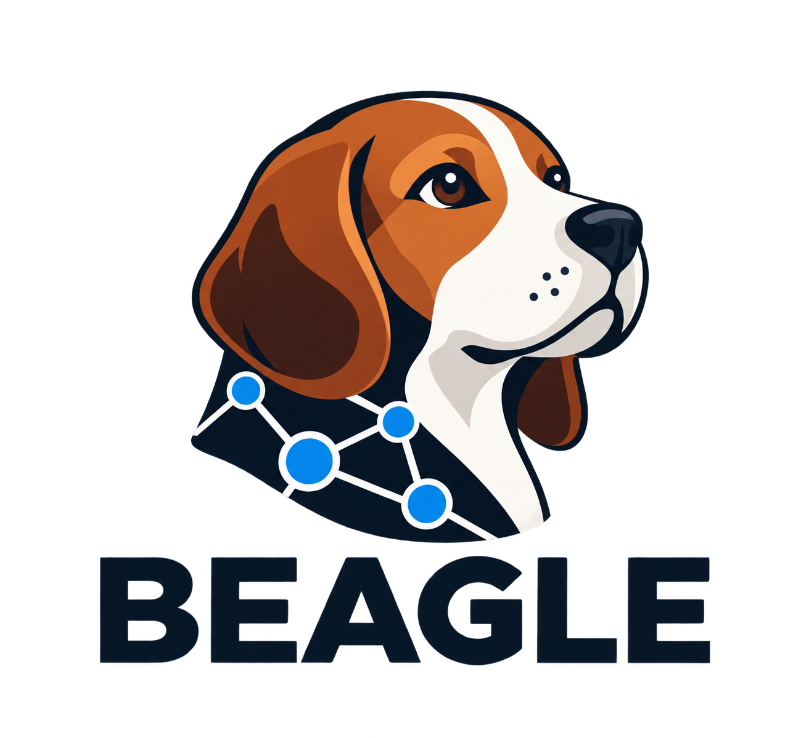

# Beagle

<p align="center">
  
</p>

A small, headless Active Directory graph analysis library and CLI built with Rust
and GraphQLite.

## Build

Install Rust 1.94.1 (pinned in `rust-toolchain.toml`), a C compiler, Bison, and Flex, then build:

```sh
cargo build --locked --release
```

Cargo verifies and extracts the tracked GraphQLite source archive, generates its
parser with Bison and Flex, and compiles the native library using the C compiler.
The public query catalogs and their provenance are also tracked. Normal builds
do not need Python, PyYAML, angreal, or Make. Private collections and compatibility
validation fixtures are never needed by CI.

On Debian or Ubuntu, install `build-essential bison flex`. On macOS, install
the Xcode command-line tools and `brew install bison flex`, then set `BISON` and
`FLEX` to their Homebrew executable paths (or add their `bin` directories to
`PATH`). The CI build targets macOS 13 or later.

Windows builds use the `x86_64-pc-windows-gnu` target and MSYS2 MINGW64. Install
MSYS2's `mingw-w64-x86_64-gcc`, `bison`, and `flex` packages, put `mingw64/bin` and
`usr/bin` on `PATH`, and build with
`cargo build --locked --release --target x86_64-pc-windows-gnu`. Cargo downloads
and verifies the pinned static POSIX libraries into its build directory. To use
your own libraries, set `BEAGLE_WINDOWS_POSIX_ROOT` to a `mingw64` prefix containing
`include/regex.h` and `lib/{libsystre,libtre,libintl,libiconv}.a`.
For offline Windows builds, use that prefix override or set `CARGO_NET_OFFLINE=true`
after the packages have been cached. Cargo's `--offline` flag alone does not
disable downloads performed by build scripts.

The shared [build setup](.github/actions/setup-build/action.yml) installs these
native tools for CI. `BISON`, `FLEX`, and the standard `cc` crate toolchain
environment variables can select alternative native tools.

Maintainers can reproduce the tracked public inputs with
`python3 -m pip install PyYAML==6.0.3` followed by
`python3 .github/scripts/prepare-build.py`. This optional refresh verifies pinned
upstream checksums and preserves any differing local files. Changes to upstream
pins and generated inputs must be reviewed together with `vendor/build-inputs.json`.

## Desktop integration

`beagle helper-stdio` provides a bounded, versioned JSON-lines protocol with one
persistent database connection. See the [desktop helper protocol](docs/helper-stdio.md)
for framing, commands, limits, errors, and host responsibilities. The original
`serve-stdio` protocol and ordinary CLI commands remain available.

`beagle --build-info` prints the embedded version, helper protocol, source
revision, and target without opening a database. Release workflows require an
exact source revision and verify it against the release checkout before packaging.

## Checks and releases

[Build checks](.github/workflows/build.yml) run on pushes and pull requests for
Linux x64, macOS ARM64 and Intel, and Windows x64. They check formatting, lint,
test the CLI and library, and run an independent library consumer.

[Releases](.github/workflows/release.yml) run when a `v*` tag is pushed. The tag
must match `Cargo.toml` (for example, `v0.1.0`). Every platform must build and
pass its checks before binary archives, license notices, provenance, and SHA-256
checksums are published to a GitHub release. Release packages contain no private
data or compatibility fixtures. Python 3.13 is installed only for release
packaging and validation; it is not part of compilation or tests.

Desktop consumers can pin a release archive and its SHA-256 at application build
time. Each archive contains the executable, license notices, and
`BUILD-PROVENANCE.json` with the source commit/tree, exact Rust toolchain,
locked dependency hash, native build inputs, helper protocol, and executable
SHA-256. `beagle-runtime-manifest.json` collects those identities and archive and
executable hashes for every target. `SHA256SUMS` also covers that manifest. Verify
the pinned archive before extracting and bundling it; applications do not need
to download a helper at runtime. macOS apps can combine the two verified Mach-O
executables with `lipo` when creating a universal application.

`ROADMAP.md` is a local planning file and is excluded from Git.
